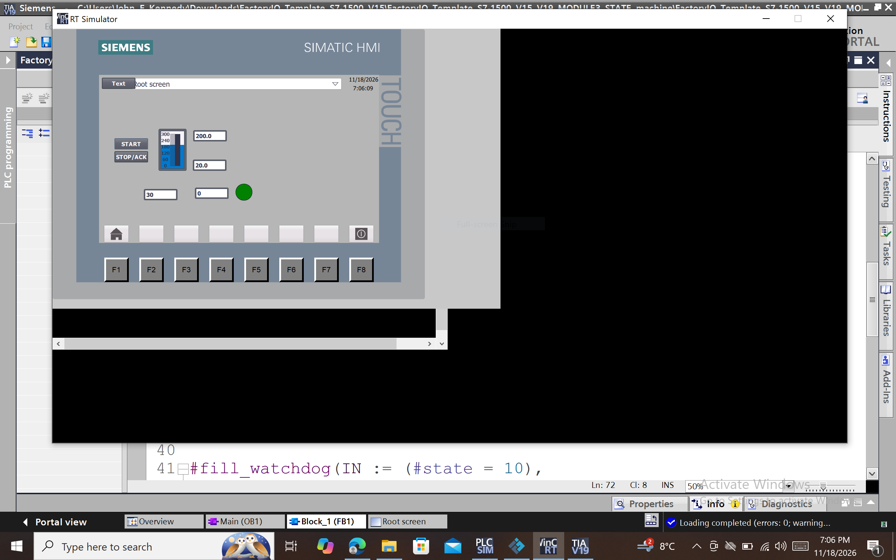
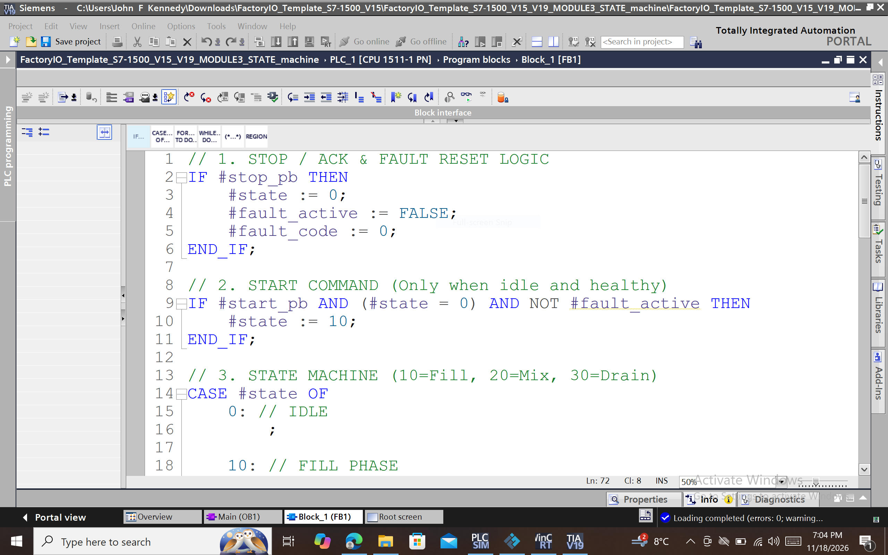

# Automated Batch Tank Process Control & HMI Co-Simulation (S7-1500 / SCL / WinCC)

A deterministic, closed-loop batch tank automation system built in **Siemens TIA Portal V19** using **IEC 61131-3 Structured Control Language (SCL)** on a **SIMATIC S7-1500 (`CPU 1511-1 PN`)** PLC paired with a **SIMATIC HMI (`KTP700 Basic PN`)**.

---

## System Previews

### WinCC Runtime HMI & Live Simulation


### TIA Portal V19 — SCL State Machine (`FB1`) & `OB1` Integration


---

## Key Engineering Features
* **Deterministic Finite-State Machine (`FB1`):** Structured `CASE`-based state architecture (`0 = Idle`, `10 = Fill`, `20 = Mix`, `30 = Drain`) ensuring predictable transitions and safe output de-energization on stop or fault.
* **Process Safety & Watchdog Diagnostics:** Built-in `TON` fill watchdog (`15 s`) detects stalled fill cycles, latches `fault_active`, outputs diagnostic `fault_code = 2`, and enforces explicit operator acknowledgment (`STOP/ACK`) prior to recovery.
* **Bidirectional Operator Interface (`WinCC Basic`):** Live HMI screen featuring real-time tank level bar graph visualization (`0–300 cm`), high/low setpoints (`high_sp`, `low_sp`), momentary pushbuttons (`SetBitWhileKeyPressed`), and color-coded status indicators.
* **Self-Contained Virtual Plant Simulation:** Integrated dynamic level physics inside `FB1` (`+0.15 cm/scan` fill, `-0.15 cm/scan` drain) eliminates external 3D driver bottlenecks.

---

## System Architecture & Tech Stack

| Component | Specification |
| :--- | :--- |
| **Engineering Environment** | Siemens TIA Portal V19 |
| **PLC Hardware Target** | SIMATIC S7-1500 — `CPU 1511-1 PN` |
| **Programming Language** | IEC 61131-3 SCL (Function Block `FB1` + Instance DB `DB1`) |
| **HMI Target** | SIMATIC HMI `KTP700 Basic PN` |
| **Simulation Environment** | Siemens S7-PLCSIM + WinCC Runtime Simulator |

---

## State Machine & Fault Logic

```text
  [ 0: IDLE ] ──( START & !Fault )──► [ 10: FILL ] ──( Level >= High_SP )──► [ 20: MIX (5s) ]
       ▲                                   │                                        │
       │                        ( Fill Watchdog > 15s )                    ( Mix Timer Done )
       │                                   ▼                                        ▼
       └──( STOP/ACK )─── [ FAULT LATCHED (Code 2) ] ◄──( Level <= Low_SP )── [ 30: DRAIN ]
